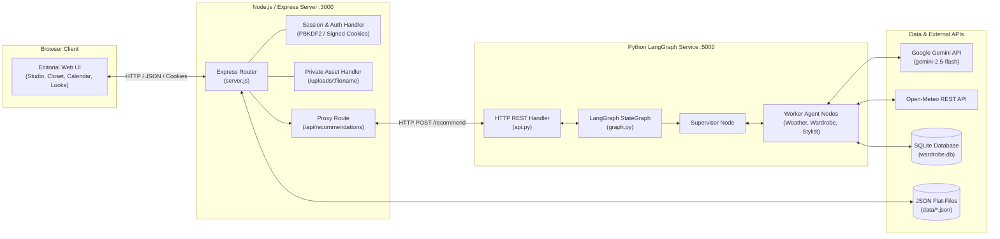
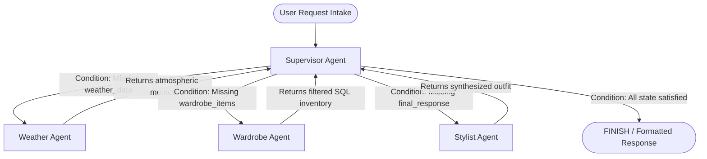

# ThreadTheory

[](https://github.com/Aashi0105/ThreadTheory/actions/workflows/ci.yml)

> An AI-powered digital wardrobe and multi-agent styling platform that curates cohesive, weather-appropriate outfits strictly from clothes you actually own.

**Status:** working prototype. A shop-focused version is in development: [Moda](https://github.com/Aashi0105/Moda).

---

## 📌 Project Overview & Problem Statement

ThreadTheory tackles the pervasive daily dilemma: *"a closet full of clothes, but nothing to wear."* While commercial generative AI models can generate appealing fashion concepts, standard LLMs often propose garments the user does not own, disregard local atmospheric conditions, and lack database grounding.

ThreadTheory addresses this by combining:
1. **Grounded Inventory Management**: Outfit recommendations are validated against the user's personal digital closet stored in SQLite (`wardrobe.db`), constraining recommendations to verified wardrobe records.
2. **Real-Time Weather Integration**: Live atmospheric conditions (temperature, precipitation probability, wind speed) from Open-Meteo dynamically filter suitable clothing layers and fabrics.
3. **Multi-Agent Orchestration**: A specialized LangGraph state machine coordinates dynamic routing between dedicated Weather, Wardrobe, and Stylist agents to produce complete, cohesive outfits with transparent reasoning traces.

> **Local Prototype Notice**: ThreadTheory is currently engineered as a **functional local prototype** designed for single-user evaluation and developer testing. It is **not yet ready for public multi-user production deployment** without addressing architectural limitations such as concurrent file writes, unauthenticated microservice endpoints, and absent rate limiting.

---

## ✨ Features Verified in Codebase

* **Multi-Agent Outfit Studio**: Interactive canvas to generate outfits from natural language prompts (e.g., *"business casual for rainy morning"*), inspect agent reasoning traces, and swap individual pieces.
* **Database-Grounded Recommendations**: Recommendations are constrained by database-backed item-ID validation against SQLite (`wardrobe.db`), significantly reducing the risk of hallucinated garments.
* **Atmospheric Layering Logic**: Real-time temperature and weather metrics filter garments by warmth boundaries and weather appropriateness.
* **Digital Wardrobe Management**: Categorize and inspect garments across tops, bottoms, outerwear, shoes, and accessories with subcategory, color, occasion, formality, and temperature ratings.
* **Multi-Dimensional Inspiration Lookbook**: Curated gallery of 300 lookbook cards across 15 color stories, 15 color combinations, 15 aesthetics, and 5 style movements with dynamic board filtering.
* **"Build This Look" & Gap Analysis**: Cross-references inspiration lookbook boards against personal closet inventory to identify matching items and flag missing wardrobe essentials.
* **Scrapbook "My Looks"**: Visual lookbook to save favorite outfits, inspect coordinate breakdowns, re-open looks in the Studio, or schedule them on the calendar.
* **Outfit Calendar & Planner**: Schedule outfits for specific calendar dates with persistent daily tracking and monthly navigation.
* **Style DNA Diagnostic**: Multi-step interactive quiz identifying personal style archetypes, dominant color palettes, and fit preferences.

---

## 🏗️ System Architecture

ThreadTheory follows a decoupled, three-tier architecture:

```
[ Browser Client ]
       │
       ▼ (HTTP / JSON / Cookies)
[ Node.js / Express Web Server (:3000) ]
   ├── Authentication & Session Management (HMAC-SHA256, PBKDF2)
   ├── User Data Stores (data/*.json)
   ├── Private Wardrobe Media Serving (/uploads/:filename)
   └── LangGraph Proxy Endpoint (/api/recommendations)
       │
       ▼ (HTTP POST :5000/recommend)
[ Python LangGraph Microservice (:5000) ]
   ├── LangGraph StateGraph (Supervisor Orchestrator)
   ├── Weather Agent (Open-Meteo REST API)
   ├── Wardrobe Agent (SQLite wardrobe.db)
   └── Stylist Agent (Google Gemini 2.5 Flash / Deterministic Engine)
```

### High-Level System Architecture Diagram



---

## 🤖 Multi-Agent Workflow & SQL Grounding

### Agent Orchestration Flow

Reasoning is coordinated across **3 specialized worker agents** managed by a central **Supervisor Agent** using a compiled LangGraph `StateGraph`:



| Agent Node | Implementation | Responsibility & Tools |
| :--- | :--- | :--- |
| **Supervisor Agent** | `graph.py` (`supervisor_node`) | Inspects shared `AgentState` gaps and dynamically routes to the next agent until all requirements are satisfied, terminating at `FINISH`. |
| **Weather Agent** | `agents/weather_agent.py` | Parses target city and fetches live atmospheric metrics (temperature, condition, precipitation probability, wind speed) via Open-Meteo REST API (`tools/weather.py`). |
| **Wardrobe Agent** | `agents/wardrobe_agent.py` | Queries `wardrobe.db` via `tools/wardrobe.py` to retrieve verified user clothing matching requested category, formality, and temperature comfort limits. Includes deterministic fast-path query parsing to conserve LLM quotas. |
| **Stylist Agent** | `agents/stylist_agent.py` | Evaluates verified wardrobe candidates against user prompt and weather forecast using Google Gemini (`gemini-2.5-flash`), generating cohesive coordinates and stylist rationale. In deterministic mode (`USE_DETERMINISTIC_STYLIST=true`), executes rule-based compatibility selection. |

### Grounding & Defensive Parsing Pipeline

1. **SQL Parameterization**: The Wardrobe Agent interacts with SQLite using parameterized SQL queries (`?` bindings) in `tools/wardrobe.py`, strictly scoping queries by user email (`LOWER(owner) = LOWER(?)`) to ensure multi-tenant data isolation.
2. **Defensive Markdown Sanitization**: In `api.py`, `parse_outfit_from_text` removes Markdown artifacts (such as `**bold**`, `_italics_`, and `` `code` ``) from the LLM output using regular expressions.
3. **Database Object Binding**: Item names and IDs from the sanitized LLM response are validated and cross-referenced directly against user wardrobe records in SQLite; items that cannot be resolved to a verified database record are rejected.
4. **Garment Compatibility Enforcement**: Logic enforces category exclusivity (e.g., selecting a dress or jumpsuit suppresses the bottom coordinate).

---

## 🔐 Security Architecture & Hardening

ThreadTheory incorporates defense-in-depth protections verified through automated regression suites:

* **PBKDF2-HMAC-SHA512 Password Hashing**:
  * Passwords stored in `data/users.json` using salted PBKDF2 with SHA-512 (`crypto.pbkdf2Sync(password, salt, iterations, 64, 'sha512')`).
  * Modern accounts hashed with **210,000 iterations** formatted as `iterations:salt:hash`.
  * Backward compatibility for legacy 1,000-iteration hashes with automatic rehash-on-login to 210,000 iterations.
  * Iteration counts bounded between 1,000 and 500,000 to prevent denial-of-service via malformed iteration counts.
  * Automatic on-boot migration for any legacy plaintext passwords.
* **Cryptographically Signed Sessions**:
  * Sessions issue 24-byte cryptographically random session IDs signed with HMAC-SHA256 (`id.signature`) using `SESSION_SECRET`.
  * Cookie signatures verified with constant-time equality checks (`crypto.timingSafeEqual`) to prevent timing attacks.
* **Route Authorization & IDOR Defenses**:
  * `requireAuth` middleware gates all user-scoped endpoints (`/api/wardrobe`, `/api/planner`, `/api/saved-looks`, `/api/moodboards`, `/api/recommendations`), rejecting unauthenticated requests with HTTP 401.
  * Data queries and mutations strictly enforce ownership via `req.user.email`. Client-supplied body or query parameters cannot override the session identity.
* **Private Wardrobe Upload Authorization**:
  * User-uploaded garment images are saved outside the public web root in `data/uploads/wardrobe/`.
  * Images are served exclusively via authenticated `GET /uploads/:filename`, which validates active session, enforces strict filename regex (`^image-[0-9]+-[0-9]+.*$`), verifies path canonicalization against directory traversal (`..`), and verifies that the item belongs to `req.user.email`.
  * Responses set strict cache headers: `Cache-Control: private, no-store, max-age=0`.
* **Static File Whitelisting**:
  * Public static delivery is restricted to allowlisted HTML pages and files inside `public/`.
  * Direct requests for sensitive files (`server.js`, `package.json`, `data/*.json`, `wardrobe.db`, `.env`) and path traversals return HTTP 404.
* **Fail-Closed Production Restrictions**:
  * When `NODE_ENV=production`, `server.js` mandates a minimum 32-character `SESSION_SECRET` on boot, failing closed immediately if absent or insecure.
  * Debug and mock-seeding endpoints are disabled in production.

---

## 🛠️ Tech Stack & Major Libraries

| Layer | Technologies & Libraries |
| :--- | :--- |
| **Frontend** | HTML5, Vanilla JavaScript, CSS, Google Fonts (*Bodoni Moda*, *Cormorant Garamond*, *Jost*, *Caveat*) |
| **Web Server** | Node.js (v18+ / v20), Express 4.19, Multer 1.4, Body-Parser 1.20, CORS 2.8 |
| **Microservice Backend** | Python 3.12, Built-in `http.server.ThreadingHTTPServer` |
| **Agent Framework** | LangGraph (>=0.2.0), LangChain Core (>=0.3.0), LangChain Google GenAI (>=2.0.0) |
| **LLM Model** | Google Gemini (`gemini-2.5-flash`) via `langchain-google-genai` |
| **Databases & Storage** | SQLite (`wardrobe.db` with parameterized queries), Flat-file JSON (`data/*.json`) |
| **External APIs** | Open-Meteo REST API (real-time weather forecasting), Pexels API (lookbook imagery) |
| **Testing** | Pytest (Python test suite), Node.js native assert test runner |
| **CI / Automation** | GitHub Actions (`.github/workflows/ci.yml`) |

---

## 📁 Repository Structure

```text
ThreadTheory/
├── .github/
│   └── workflows/
│       └── ci.yml              # GitHub Actions CI workflow
├── agents/                     # LangGraph agent definitions
│   ├── stylist_agent.py        # Gemini outfit synthesis agent & prompt templates
│   ├── wardrobe_agent.py       # Inventory filtering agent & fast lookup
│   └── weather_agent.py        # Open-Meteo weather agent
├── tools/                      # Agent tool implementations
│   ├── wardrobe.py             # SQLite parameterized query interface
│   └── weather.py              # Open-Meteo geocoding & forecast client
├── tests/                      # Automated test suite
│   ├── test_api.py             # Python REST API & markdown parsing tests
│   ├── test_app.py             # Application import & package tests
│   ├── test_auth_foundation.js # Node.js auth & PBKDF2 assertions (13 assertions)
│   ├── test_graph.py           # LangGraph supervisor state orchestration tests
│   ├── test_phase2_verification.py # Outfit compatibility & constraint tests
│   ├── test_route_authorization.js # Node.js route authorization & IDOR tests (117 assertions)
│   ├── test_static_exposure.js # Node.js static exposure & traversal tests (41 assertions)
│   ├── test_stylist_agent.py   # Stylist agent unit tests
│   ├── test_wardrobe_agent.py  # Wardrobe agent unit tests
│   ├── test_wardrobe_tool.py   # SQLite database tool tests
│   ├── test_weather_agent.py   # Weather agent unit tests
│   └── test_weather_tool.py    # Open-Meteo integration tests
├── data/                       # Local JSON datastores and private uploads
│   └── uploads/wardrobe/       # Private user garment images (session-authorized)
├── public/                     # Public static assets and lookbook images
├── api.py                      # Python HTTP REST API server (Port 5000)
├── app.py                      # Python application entry point
├── graph.py                    # LangGraph StateGraph & supervisor routing
├── server.js                   # Node.js/Express web server (Port 3000)
├── setup_db.py                 # SQLite wardrobe database initialization script
├── test_env.py                 # Environment verification script
├── requirements.txt            # Python dependencies
├── package.json                # Node.js dependencies
└── .env.example                # Environment variable template
```

---

## 🚀 Getting Started

### Prerequisites

* **Node.js**: v18 or later (v20 recommended)
* **Python**: 3.10 to 3.12
* **Google Gemini API Key**: Obtainable from [Google AI Studio](https://aistudio.google.com/)

### 1. Clone Repository

```bash
git clone https://github.com/Aashi0105/ThreadTheory.git
cd ThreadTheory
```

### 2. Python Environment Setup

Create and activate a virtual environment, then install Python dependencies:

**Windows (PowerShell):**
```powershell
python -m venv venv
.\venv\Scripts\Activate.ps1
pip install -r requirements.txt pytest
```

**macOS / Linux:**
```bash
python3 -m venv venv
source venv/bin/activate
pip install -r requirements.txt pytest
```

### 3. Node.js Setup

Install Node.js dependencies:

```bash
npm install
```

### 4. Database Initialization

Generate and seed the local SQLite database (`wardrobe.db`):

```bash
python setup_db.py
```

> **Note**: `wardrobe.db` is intentionally excluded from Git. Running `setup_db.py` creates and seeds it locally.

### 5. Environment Variables Configuration

Copy the example environment template:

```bash
cp .env.example .env
```

Configure `.env`:
```env
# Required for Gemini LLM styling
GEMINI_API_KEY=your_gemini_api_key_here
GOOGLE_API_KEY=your_gemini_api_key_here

# Session Secret (minimum 32 characters in production)
SESSION_SECRET=your_secure_session_secret_minimum_32_characters_here

# Server Ports (defaults: Express runs on 3000, Python LangGraph service runs on 5000)
PORT=3000
LANGGRAPH_PORT=5000

# Optional test flag (bypasses live Gemini calls during local testing)
USE_DETERMINISTIC_STYLIST=false
```

### 6. Verify Environment

Run the automated diagnostic check:

```bash
python test_env.py
```

### 7. Running the Application

Start both services in separate terminals:

**Terminal 1 — Python LangGraph REST API:**
```bash
python api.py
```
*Service runs at `http://localhost:5000` (`POST /recommend`)*

**Terminal 2 — Node.js / Express Web Server:**
```bash
node server.js
```
*(Alternatively: `npm run backend`)*
*Web application runs at `http://localhost:3000`*

Open `http://localhost:3000` in your web browser.

---

## 🧪 Testing & Verification

ThreadTheory includes an automated test suite comprising **30 Python tests** and **171 Node.js security assertions**, based on previously reported baseline test runs and verified in GitHub Actions CI (not rerun during this documentation review):

### 1. Python Test Suite (30 Tests)

Tests LangGraph state orchestration, supervisor routing, SQLite queries, weather tools, Markdown parsing, and outfit compatibility rules.

Setting `USE_DETERMINISTIC_STYLIST=true` (as in CI) routes stylist evaluations through the rule-based engine, allowing tests to run deterministically and offline without consuming Gemini API quota. If unset, tests will attempt to query Gemini if an API key is configured in `.env`, falling back to deterministic recommendations upon API error.

```bash
# Recommended for deterministic, offline testing (as configured in CI):
# Windows (PowerShell):
$env:USE_DETERMINISTIC_STYLIST="true"; python -m pytest tests/ -v

# macOS / Linux:
USE_DETERMINISTIC_STYLIST=true python -m pytest tests/ -v

# Standard execution:
python -m pytest tests/ -v
```

**Reported Python Test Breakdown (30 passing tests in 1.45s from baseline test run):**
* `tests/test_api.py`: 4 tests (REST handler, markdown sanitization, dress/bottom exclusivity)
* `tests/test_app.py`: 1 test (package import verification)
* `tests/test_graph.py`: 2 tests (LangGraph supervisor routing and state transitions)
* `tests/test_phase2_verification.py`: 14 tests (layering rules, color compatibility, temperature filtering)
* `tests/test_stylist_agent.py`: 2 tests (stylist prompt formatting and fallback handling)
* `tests/test_wardrobe_agent.py`: 3 tests (wardrobe filtering and fast lookup parsing)
* `tests/test_wardrobe_tool.py`: 1 test (parameterized SQLite query interface)
* `tests/test_weather_agent.py`: 1 test (weather agent execution and state output)
* `tests/test_weather_tool.py`: 2 tests (Open-Meteo forecast and geocoding integration)

### 2. Node.js Security Test Suites (171 Assertions)

Validates authentication, session cookies, route authorization, IDOR defenses, and static file exposure:

```bash
# 1. Static exposure and path traversal defenses (41 assertions)
node tests/test_static_exposure.js

# 2. PBKDF2 hashing, session signing, and auth foundation (13 assertions)
node tests/test_auth_foundation.js

# 3. Route authorization, IDOR ownership, and upload access control (117 assertions)
node tests/test_route_authorization.js
```

**Reported Node.js Assertion Breakdown (171 passing assertions from baseline test run):**
* **Static Exposure (`test_static_exposure.js`)**: 41 assertions. Verifies entry-point availability, directory traversal rejection (`..%2f`), dotfile blocking (`.env`), and denial of direct access to `wardrobe.db`, `server.js`, and `data/*.json`.
* **Authentication Foundation (`test_auth_foundation.js`)**: 13 assertions. Verifies PBKDF2-HMAC-SHA512 hashing, salt uniqueness, iteration boundaries, HMAC-SHA256 session signing, and constant-time signature validation.
* **Route Authorization (`test_route_authorization.js`)**: 117 assertions. Verifies 401 rejection on unauthenticated routes, IDOR ownership enforcement across wardrobe, looks, and planner endpoints, authenticated `/uploads/:filename` delivery, and retention of underlying files on item deletion.

---

## ⚠️ Known Limitations & Audit Findings

The following architectural limitations and unresolved findings were identified during final audit review:

1. **Python API Exposure**:
   * The Python LangGraph service (`api.py`) runs on port 5000 via Python's built-in `ThreadingHTTPServer`, binds to all network interfaces (`""`), and sets `Access-Control-Allow-Origin: *`.
   * The Python service has **no authentication middleware** of its own; it assumes it is only accessible via localhost by the Express reverse proxy.
   * *Risk*: In a cloud or network deployment where port 5000 is inadvertently exposed, unauthenticated clients could invoke `POST /recommend` directly, bypassing Express session checks and consuming Gemini API quota.
2. **Missing Rate Limiting**:
   * Neither the Express backend (`server.js`) nor the Python service (`api.py`) implements request rate limiting (e.g., via `express-rate-limit`).
   * *Risk*: Endpoints such as `/login`, `/signup`, `/api/recommendations`, and lookbook queries are unprotected against automated brute-force attacks or resource exhaustion.
3. **Concurrent JSON-Write Risks**:
   * User profiles, session tokens, saved looks, and planner schedules are stored in flat JSON files (`data/*.json`) managed via synchronous file operations (`fs.readFileSync` / `fs.writeFileSync`).
   * File operations lack file locking, atomic temporary-file-and-rename semantics, or transaction isolation.
   * *Risk*: Concurrent requests or simultaneous multi-user sessions could result in race conditions, partial overwrites, or JSON file corruption.

### Production Readiness Assessment

ThreadTheory is currently a **working local prototype**. Before deploying to a multi-user public production environment, the following engineering steps are required:
* Migrate user data and session storage from flat JSON files to a relational database (e.g., PostgreSQL) with connection pooling and ACID transactions.
* Restrict the Python service to internal IPC or bind strictly to `127.0.0.1`, adding mutual authentication (e.g., shared secret or mTLS) between Express and Python.
* Implement tiered rate limiting on authentication and recommendation routes.
* Move user-uploaded garment images from local disk to cloud object storage (e.g., AWS S3 or Google Cloud Storage) with signed temporary URLs.

---

## 👩‍💻 Author

**Aashi Vora**  
* GitHub: [https://github.com/Aashi0105](https://github.com/Aashi0105)
